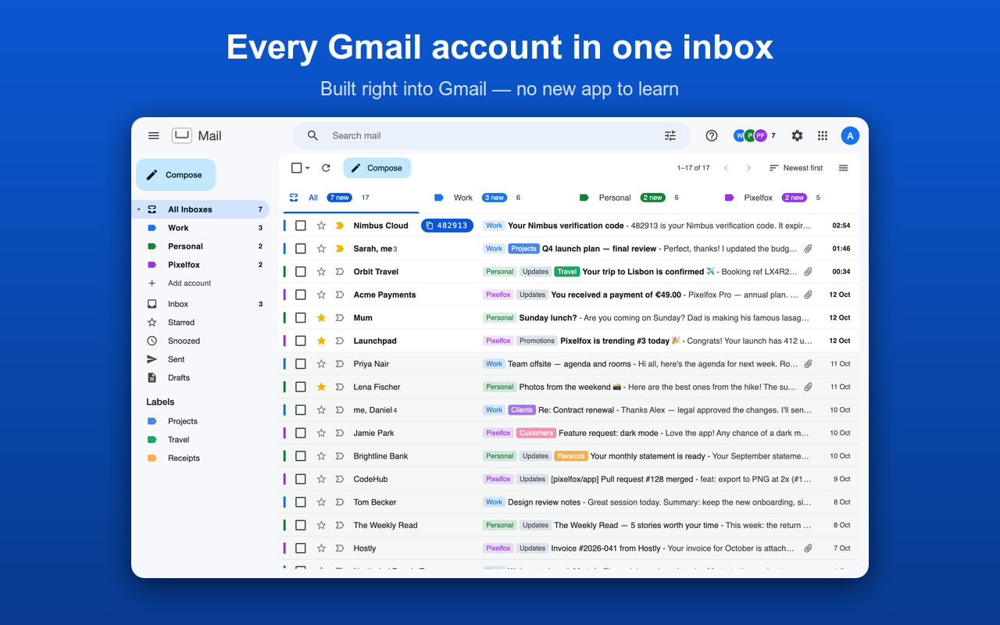
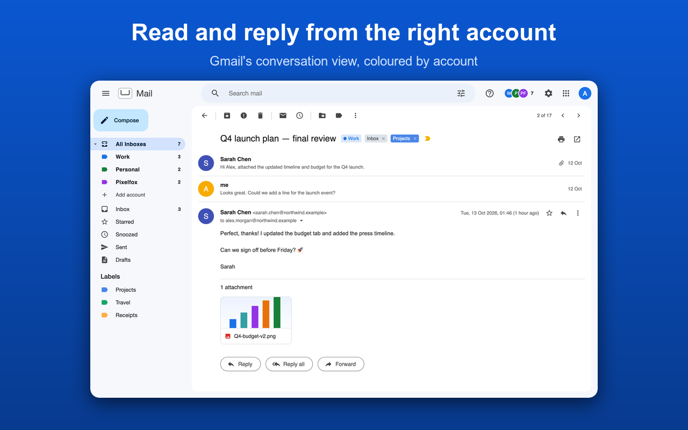

<p align="center">
  
</p>

<h1 align="center">Unified Inbox for Gmail</h1>

<p align="center">Every Gmail account in one inbox, built right into Gmail.</p>

<p align="center">
  
  
  
</p>



Unified Inbox adds an **All Inboxes** view to Gmail: the email of every Google account you
add, in one list, where you read, reply, archive, label and search without switching
accounts. It has no server: your browser talks to Google directly, and nothing is sent
anywhere else (the extension's Content Security Policy only allows Google's endpoints).

## Why you set it up yourself

It used to be on the Chrome Web Store. Google requires every app that reads and changes
Gmail (the `gmail.modify` scope) to pass a paid security assessment every year, Chrome
extensions without a server included. Instead, Unified Inbox is free and open source:
you run it with **your own Google Cloud project**. An app that you publish for yourself
without verification works for up to 100 Google accounts, which is plenty for your own
inboxes. It takes about ten minutes, once.

**Coming from the Chrome Web Store version?** It stops working on 5 November 2026. Follow
[Set up](#set-up) below, add your accounts again in the new extension, then remove the
store version from `chrome://extensions`.

## Set up

### 1. Install the extension

1. Download this repository (**Code → Download ZIP**, then unzip) or `git clone` it.
   Keep the folder where it is: Chrome derives the extension's ID from its location.
2. Open `chrome://extensions`, turn on **Developer mode** (top right), click **Load
   unpacked** and pick the folder.
3. Click the extension's icon. The popup shows a **redirect URI** like
   `https://abcdefghijklmnopabcdefghijklmnop.chromiumapp.org/`. Keep the popup handy.

### 2. Create your Google Cloud project

1. Go to <https://console.cloud.google.com/>, sign in with any Google account, and create
   a project (for example "Unified Inbox").
2. **APIs & Services → Library**: search for **Gmail API** and click **Enable**.

### 3. Configure Google's sign-in screen

In **APIs & Services → OAuth consent screen** (also called *Google Auth Platform*):

1. **Branding:** an app name (for example "My Unified Inbox") and your email.
2. **Data access:** add the scope `https://www.googleapis.com/auth/gmail.modify` (Gmail:
   read, compose and send, and organize email), plus `email` and `profile`.
3. **Audience:** user type *External*, then **Publish app** to move it from *Testing* to
   **In production**. Google says the app needs verification: that's for apps offered to the
   public, so don't submit it. Unverified, it works for up to 100 accounts and shows a
   warning when you sign in.

   *Prefer not to publish?* Leave it in *Testing* and add your Gmail addresses under **Test
   users**; Google then ends the permission every 7 days, and you sign in again.

### 4. Create the OAuth client

1. **Clients** (or **Credentials → Create credentials → OAuth client ID**).
2. Application type: **Web application**.
3. Under **Authorized redirect URIs**, add the redirect URI from the popup (step 1.3),
   exactly as shown, with the trailing `/`.
4. Create it and copy the **Client ID** (`…apps.googleusercontent.com`). There is no client
   secret to use: the extension uses the browser flow.

### 5. Connect your accounts

1. In the extension's popup, paste the client ID and click **Save**.
2. Click **Add Google account** and sign in. Google shows *"Google hasn't verified this
   app"*: it's your own app, so click **Advanced → Go to … (unsafe)** (or **Continue**). Tick
   the Gmail permission (or **Select all**).
3. Repeat for each account, then **Open All Inboxes**.

## Good to know

- **Published (In production), unverified:** no weekly sign-in; at most 100 accounts can ever
  sign in to your project, and each sees Google's warning screen once.
- **Testing:** Google ends the permission every 7 days; the extension then asks you to sign
  in to that account again.
- **Moving the folder changes the extension's ID**, and so the redirect URI: add the new
  one to your OAuth client.
- **Updating:** download the new version into the same folder (or `git pull`) and click
  the reload icon in `chrome://extensions`.
- **Removing an account** in the popup also revokes its token at Google.

## Sharing it with friends

One OAuth client can serve you and the people you give the extension to (up to 100
accounts in total), so they don't need a Google Cloud project of their own:

1. Create a key once, and keep it outside the repository: it fixes the extension's ID.

   ```sh
   openssl genrsa -out ~/unified-inbox-key.pem 2048
   ```

2. Build with your client ID; the script prints the redirect URI to add to the client.

   ```sh
   scripts/build-shared.sh ~/unified-inbox-key.pem 1234-abc.apps.googleusercontent.com
   ```

3. Send them `dist/unified-inbox-shared-<version>.zip`. They unzip it, load the
   `unified-inbox` folder with **Load unpacked**, and sign in; there's nothing to paste.

Use the same key for every new version, or the ID (and the redirect URI) changes.

## How it works

| Part | What it does |
| --- | --- |
| `background/service-worker.js` | Sign-in per account (`chrome.identity.launchWebAuthFlow`, token flow), Gmail API calls paced under Google's per-minute quota, periodic sync with `chrome.alarms`, notifications |
| `content/inject.js` | The All Inboxes view inside Gmail: list, reader, actions, labels, search, replies |
| `popup/` | Accounts, your OAuth client ID, sync |
| `background/config.js` | Reads your client ID from `chrome.storage.local` |

Requests are paced per account with a token bucket (a burst of 3,000 units, then 10,000 a
minute, below Gmail's 15,000), keeping a reserve so opening or archiving a conversation
never waits behind the background sync.



## Privacy

Your email, tokens and settings stay in your browser and your Google account. There's no
server, no analytics and no third party. The extension can only connect to
`gmail.googleapis.com`, `www.googleapis.com`, `oauth2.googleapis.com` and
`accounts.google.com`.

## Contributing

Issues and pull requests are welcome. Bug or idea: [contact@mccprogrammer.com](mailto:contact@mccprogrammer.com).
If it saves you time, you can [support it on Ko-fi](https://ko-fi.com/mccprogrammer).

## License

[MIT](LICENSE)
